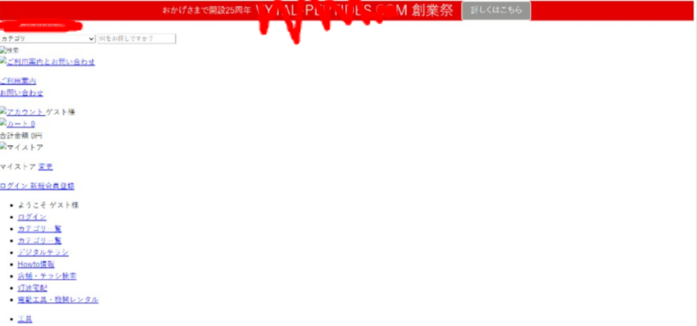

# VETO: WP Spectra

**Static and Dynamic Security Analysis of WordPress Plugins**

**Scan. Observe. Report.**

## Motivation

The project was motivated by a reported client WordPress compromise associated
with a suspicious plugin and SEO-spam injection. Diagnosis and cleanup took
approximately **three hours**. This incident is project motivation, not a sample
in the final controlled evaluation.

**Example of the compromised surface (SEO spam overlay):**



VETO aims to shorten that investigation loop: inspect the plugin package, observe runtime behavior in isolation, and give administrators a structured evidence report before trusting the plugin on production.

| | |
|---|---|
| **Course** | CS3002 Information Security |
| **Institution** | National University of Computer and Emerging Sciences (FAST NUCES), Lahore |
| **Department** | Computer Science |
| **Project Advisor** | Sarah Abid Khan |

## Group Members

| Name | Roll Number |
|------|-------------|
| Muhammad Ahmad Butt | 23L-3059 |
| Ali Ahmed | 23L-3067 |
| Muhammad Zain Tahir | 23L-3078 |

## Goals (Information Security)

| Pillar | Objective |
|--------|-----------|
| **Scan** | Static analysis of plugin ZIPs |
| **Observe** | Dynamic analysis in isolated WordPress |
| **Report** | Evidence based security report |


## Project status

**All four technical phases are implemented and locally verified against the
objectives in the [project proposal](03.pdf).** Controlled evaluation and academic
materials are prepared. Actual contribution confirmation, teammate reproduction,
viva readiness, final team review and institutional submission remain human
closeout steps.

| Phase | Delivered work | Status |
|---|---|---|
| 1 | Safe ZIP intake, hashes, PHP/YARA checks, explainable static findings and schemas | Implemented and verified |
| 2 | Disposable WordPress execution, five behavior categories, failure evidence and verified cleanup | Implemented and verified |
| 3A | Browser submission, background analysis, progress, history and restart recovery | Implemented and verified |
| 3B | Evidence inspection, before/after records, timeline, review policy, clean controls and coverage | Implemented and verified |
| 3C | Immutable matching PDF/JSON exports, retained downloads and fresh-install checks | Implemented and verified |
| 4 | Frozen evaluation, all five metrics, error analysis, reproducibility and submission materials | Technical work delivered; human academic closeout pending |

The full regression suite passes **100 tests** and **137 independent result/report
audit checks** pass. Fresh offline virtual-environment replay reproduced identical
metric bytes. See the [Phase 4 completion record](veto/docs/PHASE4_COMPLETION.md).

## Controlled evaluation results

Phase 4's controlled evaluation is now saved under
[the compact evaluation summary](veto/evaluation/results/summary.json).
On 16 synthetic static cases: precision **6/8 (75%)**, recall **6/8 (75%)**,
and benign static false-positive rate **2/8 (25%)**. Nine runtime runs confirm
23 behavior instances, with **22/23 (95.65%)** detected. Reports preserve
**909/909 (100%)** recorded runtime events in full JSON and the PDF index.
These small same-author samples do not establish general malware accuracy.
All nine runtime sandboxes completed and were cleaned up.

| Metric | Raw count | Result |
|---|---:|---:|
| Static precision | 6 / 8 flagged packages | 75.00% |
| Static recall | 6 / 8 suspicious packages | 75.00% |
| Static false-positive rate | 2 / 8 benign packages | 25.00% |
| Dynamic event detection | 22 / 23 confirmed behavior instances | 95.65% |
| Report completeness | 909 / 909 recorded runtime events | 100.00% |

The dataset contains eight benign and eight suspicious static cases, eight runtime
fixtures and a separate clean control, with one trial per case. Static confusion
matrix: **TP=6, FP=2, TN=6, FN=2**, with no incomplete static cases.
Ground truth combines controlled fixture assertions and separate direct file/SQL
reads. Transient/network confirmation relies on fixture return assertions rather
than independent packet capture.

False positives include inert documentation matched by raw YARA and a legitimate
fixed maintenance command. Two indirect command-call constructs are static
misses; the runtime miss is a failed direct-IP socket attempt outside the monitored
HTTP/DNS paths. Report completeness measures preservation of recorded events,
not whether all executed behavior was observed.

Start with the [submission package](veto/submission/README.md),
[evaluation protocol](veto/evaluation/PROTOCOL.md), and
[completion record](veto/submission/COMPLETION.md). Actual contribution statements,
teammate reproduction, viva readiness and institutional submission still require
the people involved. No such attestations are fabricated.

## Quick start

The verified platform is Windows with CPython 3.13. From the repository root:

```powershell
cd veto
python -m venv .venv
.\.venv\Scripts\python.exe -m pip install -r requirements-lock.txt
.\.venv\Scripts\python.exe -m wp_spectra serve
```

If the environment already exists, skip recreating it and use its Python
executable. Open **http://127.0.0.1:8765**. Full analysis requires Docker Desktop's
Linux engine and the dedicated images from the
[sandbox setup guide](veto/docs/PHASE2_GUIDE.md). Static inspection and viewing
retained reports do not require Docker. No Node build or hosted service is needed.

## Application workflow

The dashboard supports ZIP uploads, background static/full
analysis, live progress and persistent history. See the
[startup and workflow guide](veto/Readme.md). Docker is needed only for full mode.

Investigation views now include located static findings, runtime before/after
evidence, timeline filters, a versioned review policy, clean-control comparison,
and explicit coverage/limitations. Restart an already running server to load new
routes; existing saved analyses remain inspectable. Matching immutable PDF/JSON
reports are available under **Saved investigation reports**, including incomplete
outcomes and optional clean controls. Exports survive restart and do not rerun
plugins. Final controlled measurements and academic materials are linked above.

## Phase 1 implementation

The local static analyzer is implemented in [`veto/`](veto/Readme.md), with safe ZIP
intake, YARA/PHP checks, hashes, structured evidence, fixtures, and acceptance tests.
See the [setup and CLI guide](veto/Readme.md) and
[completion record](veto/docs/PHASE1_COMPLETION.md). It runs independently of the
legacy WordPress/CEGA lab and does not execute submitted plugins.

## Phase 2 implementation

The explicit local `observe` command now supports disposable WordPress execution,
external behavioral observation, controlled networking, and verified cleanup.
See the [Phase 2 setup and demonstration guide](veto/docs/PHASE2_GUIDE.md).
It uses a separate analysis environment and leaves the existing lab untouched.

WordPress sites rely on third party plugins for functionality. A malicious, compromised, or vulnerable plugin can inject spam links, alter content, create unauthorized accounts, or establish persistence. Some of that behavior only becomes visible when the plugin runs.

## Evidence included in Git

The [evaluation index](veto/evaluation/README.md) documents the case manifest and
compact evidence reviewers can inspect without the local artifact folder:

| Record | Purpose |
|---|---|
| [Case manifest](veto/evaluation/manifest.json) | Labels, rationale, versions, hashes and expected behaviors |
| [Result summary](veto/evaluation/results/summary.json) and [metrics](veto/evaluation/results/metrics.csv) | Counts, percentages, confusion matrix and errors |
| [Frozen configuration](veto/evaluation/results/freeze.json) | Original settings, source hashes, environment and Docker image IDs |
| [Ground-truth summary](veto/evaluation/results/ground-truth-summary.json) | Fixture assertions, confirmed behaviors and matching event references |
| [Regression summary](veto/evaluation/results/regression-summary.json) | Successful 100-test result and source-log hash |
| [Audit verification](veto/evaluation/results/verification.json) | All 137 result/report checks |
| [Cleanup proof](veto/evaluation/results/cleanup.json) | Independent resource listings and nine runtime cleanup outcomes |

Hashes and references link to retained raw records; they are not digital
signatures or substitutes for the full experiment evidence.

## Local artifacts excluded from Git

The root `.gitignore` excludes `/Evaluations/`. Generated artifacts are preserved
locally in this structure:

```text
Evaluations/
├── runs/final-v1/       Raw results, ground truth, report pairs and frozen source
├── samples/             Generated evaluation ZIPs and readable fixture sources
├── submission/          Final report, HTML/PDF slides, screenshots and backup video
├── verification/        Full logs, audit, reproduction and QA records
├── packages/            Complete submission ZIP
├── exports/             Additional preserved report export
└── qa/                  Rendered pages, slide previews and video inspection frames
```

**A fresh clone does not contain these local artifacts.** Back up `Evaluations/`
separately and share the submission ZIP when full evidence is required. Generate
samples for a new experiment or restore the saved artifacts before replaying the
original run. Historical frozen records retain their original internal paths
and hashes.

Editable report text, architecture diagram source, reproduction instructions,
viva notes, the requirement-to-evidence map and contribution record remain
versioned under [`veto/submission/`](veto/submission/README.md).

## Verification and reproduction

From `veto/`, install development dependencies and run the regression suite:

```powershell
.\.venv\Scripts\python.exe -m pip install -r requirements-dev.txt
.\.venv\Scripts\python.exe -m unittest discover -s tests -v
```

With local raw evidence restored, recalculate and audit the saved experiment
without Docker or executing submitted plugins:

```powershell
.\.venv\Scripts\python.exe -m tools.evaluate_phase4 calculate ../Evaluations/runs/final-v1
.\.venv\Scripts\python.exe -m tools.verify_phase4
```

For a new experiment with the Docker images ready:

```powershell
.\.venv\Scripts\python.exe -m tools.build_evaluation
.\.venv\Scripts\python.exe -m tools.evaluate_phase4 run --name my-reproduction
```

Use a new run name; existing runs are not overwritten. The `s-*.zip` evaluation
samples are static-only; use `d-*.zip` for controlled runtime analysis. See the
[reproduction guide](veto/submission/REPRODUCIBILITY.md) for fresh-source setup
and the distinction between automated replay and a teammate's reproduction.

## Scope and limitations

VETO supplies evidence for administrator review, not a malware-free guarantee.
The review policy is not a malware probability. The default hash catalog is
empty; PHP checks do not perform AST or data-flow analysis. Runtime observation
covers selected actions within a finite window. Application hooks can be bypassed
and snapshot checks can miss reverted states. Containers share the Linux kernel.

The project excludes AI/LLM classification, production monitoring, WAF functionality,
automatic malware removal and website remediation. See the
[rule catalog](veto/docs/RULES.md), [threat model](veto/docs/ARCHITECTURE_AND_THREAT_MODEL.md)
and [runtime guide](veto/docs/PHASE2_GUIDE.md) for detailed boundaries.

## License / academic use

Prepared for **CS3002 Information Security** at FAST NUCES Lahore. Lab assets and screenshots are for authorized coursework and demonstration only.

Actual member contributions require confirmation in the
[contribution record](veto/submission/CONTRIBUTIONS.md). Final team review,
any required teammate reproduction, viva rehearsal and institutional submission
remain the team's responsibility.
