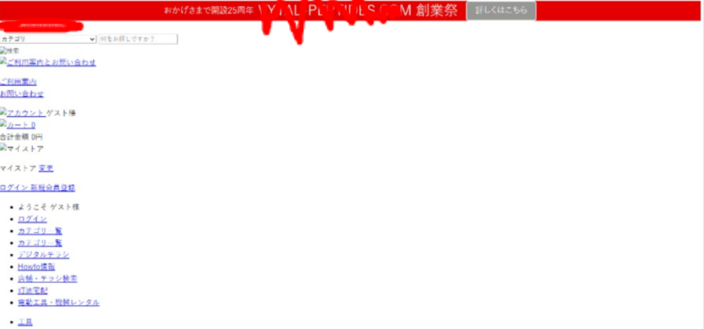

# VETO: WP Spectra

**Static and Dynamic Security Analysis of WordPress Plugins**

**Scan. Observe. Report.**

WordPress sites rely on third-party plugins for functionality. A malicious, compromised, or vulnerable plugin can inject spam links, alter content, create unauthorized accounts, or establish persistence. Some of that behavior only becomes visible when the plugin runs.

**VETO: WP Spectra** is a WordPress plugin security analysis system that combines static and dynamic analysis. It inspects a plugin package for suspicious patterns, then executes a copy in an isolated disposable WordPress sandbox, and produces an evidence-based report for administrators. Detection is rule-based (YARA, signatures, PHP patterns, behavioral monitoring)—not AI or LLMs.

| | |
|---|---|
| **Course** | CS3002 — Information Security |
| **Institution** | National University of Computer and Emerging Sciences (FAST-NUCES), Lahore |
| **Department** | Computer Science |
| **Project Advisor** | Sarah Abid Khan |

## Group Members

| Name | Roll Number |
|------|-------------|
| Muhammad Ahmad Butt | 23L-3059 |
| Ali Ahmed | 23L-3067 |
| Muhammad Zain Tahir | 23L-3078 |

---

## Motivation

The project is motivated by practical WordPress client work. In one case, a suspicious spam-SEO plugin named `dmzktif` was associated with injected foreign content and a broken storefront surface. Diagnosing and cleaning the site took roughly three hours. That experience highlighted how hard it can be to identify a suspicious plugin, understand its behavior, and preserve what it changed. (Reported as author experience, not independently verified malware attribution.)

**Example of the compromised surface (SEO spam overlay):**

VETO aims to shorten that investigation loop: inspect the plugin package, observe runtime behavior in isolation, and give administrators a structured evidence report before trusting the plugin on production.

---

## Goals

| Pillar | Objective |
|--------|-----------|
| **Scan** | Static analysis of submitted plugin ZIPs: known signatures, suspicious PHP patterns, obfuscation indicators, risky functions, and package anomalies—before execution. |
| **Observe** | Dynamic analysis in an isolated disposable WordPress environment: file/DB changes, account creation, WP-Cron changes, and outbound network attempts. |
| **Report** | Timestamped security report combining static findings and runtime events: evidence, affected files, event timeline, and risk summary (review and export). |

---

## Scope

**In scope**

1. **Static plugin analysis** — Inspect packages for signatures, obfuscation, risky PHP, and package anomalies.
2. **Dynamic behavioral analysis** — Run a plugin copy in a Docker-based WordPress sandbox; monitor selected runtime activities against a baseline.
3. **Evidence-based reporting** — Structured report with evidence, affected resources, observed events, and a risk summary.

**Out of scope**

- Real-time monitoring of production WordPress sites  
- Live HTTP traffic inspection or WAF functionality  
- Visitor routing, deception routing, or decoy traffic handling  
- Automatic malware removal, cleaning, or remediation  

Findings include supporting evidence for administrator review; they are not treated as definitive proof of maliciousness. Signature scanning may miss novel or heavily obfuscated threats; sandbox behavior may differ from production; legitimate plugins may trigger false positives.

---

## Proposed Workflow

1. **Plugin submission** — Administrator submits a plugin ZIP (or a copy of an installed plugin).
2. **Static analysis** — Unpack; YARA rules, SHA-256 checks, PHP pattern checks; record findings before execution.
3. **Sandbox initialization** — Fresh disposable WordPress via Docker; baseline files and database; restricted privileges, resource limits, controlled network.
4. **Controlled execution** — Install and activate a copy; run a predefined test sequence (frontend pages, admin actions, cron where applicable) for a fixed observation window.
5. **Behavioral monitoring** — File create/modify/delete, DB changes, unexpected users/admins, WP-Cron changes, outbound connection attempts; compare to baseline.
6. **Report and cleanup** — Combine static + dynamic findings into a timestamped report; destroy the disposable sandbox.

---

## Expected Outcomes

| Module | Description |
|--------|-------------|
| **Static Analysis** | Scanner for signatures, PHP patterns, obfuscation indicators, and risky functions. |
| **Dynamic Analysis Sandbox** | Disposable WordPress environment that runs a submitted plugin copy. |
| **Behavioral Monitoring** | Records file, DB, account, cron, and outbound network events. |
| **Evidence Report** | Exportable report: static findings, runtime observations, affected files, timeline, risk summary. |
| **Evaluation** | Tests with benign plugins and controlled cases for coverage, false positives, and event visibility. |

---

## Related Work (brief)

VETO is not a replacement for existing products. Documented emphases of selected tools include Wordfence Scan (file/malware/vulnerability scanning), Sucuri Security (malware scanning, hardening, firewall-related features), and WPScan (known vulnerabilities in core/plugins/themes). VETO’s proposed focus is a prototype workflow: accept a plugin package → static analysis → isolated execution → behavioral observation → consolidated evidence report.

---

## License / academic use

Prepared for **CS3002 Information Security** at FAST-NUCES Lahore. Lab assets and screenshots are for authorized coursework and demonstration only. Analysis is intended for self-hosted test environments where the owner has authorized security testing.
