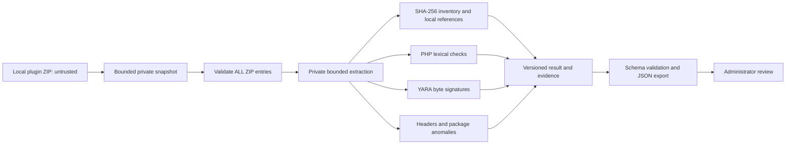

# Architecture and Threat Model

## Phase 1 data flow

The CLI calls `analyze()` and validates the returned result. Intake copies the
source into a fresh `TemporaryDirectory`, hashing that exact snapshot. Every entry
is validated before any member is written. Regular files are then streamed in
bounded chunks into private staging. Checks inspect inert bytes and never run PHP.
The context manager removes staging after successful, rejected, and failed runs.
Only bounded snippets and hashes are retained in results; the scanner does not
retain a full extracted copy.

## Trust boundaries

| Component | Trust assumption |
|---|---|
| Submitted ZIP and all names/content/headers | Untrusted; metadata is descriptive, not proof of origin. |
| CLI caller and report destination | Trusted local operator. Existing report files are not overwritten. |
| Optional `--work-dir` | Trusted existing directory; do not share it with an attacker. |
| Python, YARA library, schemas, bundled rules | Trusted application/runtime dependencies. |
| Optional hash catalog | Trusted configuration; entry labels/provenance require operator verification. |
| Report evidence | Untrusted text from a package; future HTML views must escape it. |
| `web/` WordPress lab | Outside Phase 1 execution path. |

## Threats and controls

| Threat | Implemented control | Residual limitation |
|---|---|---|
| Traversal, absolute paths, Windows drive/ADS paths | Validate every component; reject backslashes, dot segments, reserved names, invalid characters; containment check | Portable path policy intentionally rejects some ZIPs accepted on Linux. |
| Symlinks, device nodes, FIFOs | Reject non-regular Unix entry types | No claim of protection against a compromised host/runtime. |
| Case collisions, duplicate names, file/directory conflicts | Case-folded preflight index and parent checks | Names use NFC normalization policy, not exhaustive Unicode spoof detection. |
| ZIP bombs or excessive storage | Compressed bytes, entry/file count, per-file bytes, expanded total, ratio and path limits; streaming actual-byte checks | ZIP central-directory parsing is performed by Python's ZIP parser; limits are not an OS-level sandbox. |
| Encrypted or unsupported compression | Reject encrypted entries and all methods except stored/deflated | Unsupported packages require repackaging by the operator. |
| Corrupt package/CRC mismatch | ZIP parser verification; errors produce rejection/incomplete result | Novel parser/library vulnerabilities remain outside the prototype's guarantee. |
| Input replacement during scanning | Analyze a private copied snapshot and hash the same bytes | The copy may reflect concurrent source changes; its hash identifies exactly the bytes inspected. |
| Plugin-side execution | Never invoke PHP, include the plugin, or run package subprocesses | Native parsing libraries still process attacker-controlled bytes. |
| Excessive matching | Per-file YARA timeout, file-size limit, finding cap; warning/failure yields incomplete status | No whole-job wall-clock watchdog yet; total duration depends on bounded file count and contents. |
| False clean results after failure | Explicit rejected/failed statuses; coverage and errors; schema enforces incomplete summary | Static completion still cannot establish safety. |
| Accidental evidence overwrite | Exclusive output creation; partial output removed on write failure | Sudden process termination/power loss can leave an incomplete file; schema validation detects it. |

## Future integration

Phase 2 adds a separate sandbox controller and runtime collector. The analyzer
application must remain outside the plugin execution boundary. Do not execute
untrusted plugins in the current persistent host-mounted storefront unchanged.
Phase 3 consumes structured results for the dashboard and combined reporting.

No production monitoring, WAF, deception routing, AI/LLM classification, or
automatic remediation is part of this design.
