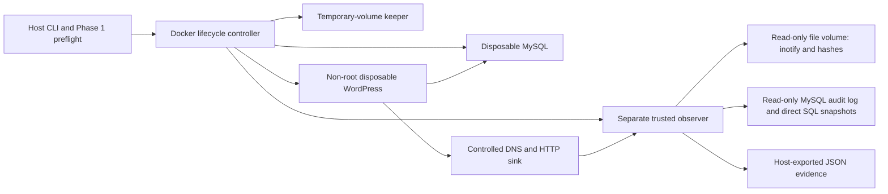

# Phase 2: Disposable WordPress Execution and Behavioral Monitoring

## Local setup

Requirements: Docker Desktop running Linux containers, Docker Engine 28+ for the
isolated bridge gateway mode, and the Phase 1 Python environment. This session
uses Engine 29.6.2. No cloud server, external backend, real credentials, or existing
WordPress site is used.

From `D:\SEMESTER-7\Information Security\Project\VETO\veto`:

```powershell
docker pull wordpress:6.8-php8.2-apache
docker pull mysql:8.0
docker pull wordpress:cli-php8.3
docker build -t veto-sandbox:phase2 sandbox
.\.venv\Scripts\python.exe -m tools.build_dynamic_fixtures
.\.venv\Scripts\python.exe -m wp_spectra observe fixtures/dynamic/behaviors.zip --output output/my-dynamic-report.json
.\.venv\Scripts\python.exe -m wp_spectra validate-dynamic output/my-dynamic-report.json
```

The images and custom sandbox image have already been prepared in this local
environment. Rebuild the custom image after changing `sandbox/runtime/`.
The first build downloads Python packages from Debian; later runs need no network
downloads when the images are present. This version deliberately uses the project's
fixed WordPress/PHP baseline, not a claim that these tags are the newest releases.
Reports record resolved image IDs/digests because upstream tags can change.

Output files must have unused names. Exit codes are `0` completed, `2` package
rejected, and `3` execution/configuration/monitoring failure. Completed execution
does not mean a plugin is safe.

## Run a clean control

```powershell
.\.venv\Scripts\python.exe -m wp_spectra observe fixtures/dynamic/benign.zip --control --output output/my-clean-control.json
```

Control mode uses the same WordPress setup/actions but installs no submitted
plugin. Input still undergoes static preflight. WordPress itself changes database
state, schedules maintenance, and attempts update checks. The control preserves
this background activity instead of pretending that every event is malicious.
Phase 3 can present side-by-side evidence and explain differences; this phase does
not claim automatic causal attribution or silently subtract all similar events.

## Execution sequence

1. Run unchanged Phase 1 static analysis. Reject incomplete intake or ambiguous
   main files before starting Docker.
2. Resolve local image IDs. Create a uniquely owned internal network in **isolated
   gateway mode**, plus size-limited temporary volumes.
3. Start a volume keeper, initialize a minimal synthetic WordPress tree, and start
   MySQL, the observer, and non-root WordPress.
4. Install WordPress with generated dummy-only passwords. Capture baseline files,
   database table/schema hashes, accounts/roles, options hashes, and cron entries.
5. Revalidate/copy the same package bytes. Install only the selected plugin tree
   as `submission/`; activate it using WP-CLI.
6. Perform a real frontend GET, log in using the synthetic administrator, visit
   the admin/plugin pages, and execute due WP-Cron tasks.
7. Observe for the configured period with repeated snapshots and continuous file,
   SQL, DNS, and HTTP collectors.
8. Fetch evidence and diagnostics before stopping containers. Remove only this
   run's owned containers, volumes, and network, and verify their absence.

The ZIP must have one conventional main PHP file at root or under one plugin
folder. If a folder layout has extra top-level files, execution is rejected rather
than silently ignoring them. Phase 1 may inspect broader layouts without executing.

## Architecture



The implementation uses Docker CLI calls with explicit argv rather than Compose.
This keeps each run's resource ownership and cleanup explicit. The legacy
`web/docker-compose*.yml` files are not started or modified by the runner.

## Isolation controls

| Component | Controls |
|---|---|
| WordPress/plugin process | UID/GID 33, all Linux capabilities dropped, no-new-privileges, read-only root filesystem, no host bind mounts or Docker socket, no published ports |
| Runtime limits | WordPress 512 MiB memory, one CPU, 96 PIDs; CLI 256 MiB; observer 384 MiB; MySQL 768 MiB |
| Storage | WordPress tmpfs volume 384 MiB, database tmpfs 768 MiB, guard tmpfs 1 MiB, bounded per-container scratch directories |
| Network | Internal bridge with isolated gateway, custom DNS sink without external forwarding, no externally published ports |
| Instrumentation | MU plugin mounted read-only; observer evidence is not mounted into the submitted plugin |
| MySQL audit | Server-side general log; plugin database user cannot change global logging configuration or access other databases |
| Host controller | Whole-job deadline, per-action timeout, bounded captured command output (32 MiB), no shell interpolation |
| Cleanup | Exact per-analysis ownership checks; no global prune or unrelated resource deletion |

The observer has only the additional capabilities needed to read the MySQL log
and bind its DNS port. Trusted initialization/database startup use a small
capability subset for ownership/user setup; submitted PHP receives none.
The keeper is required because local-driver tmpfs contents disappear after the
last mounted container exits. It mounts temporary volumes for the entire run and
is removed last. These are disposable resource identifiers, not Git tags.

## Monitoring and evidence

| Category | Collection | Evidence and boundaries |
|---|---|---|
| File | External recursive inotify plus hash snapshots | Records create/write/delete/rename; captures transient names even when no file remains. Deleted contents are not recovered; new-directory watch races remain possible. |
| Database | MySQL general log plus direct-SQL table/schema hashes | Records attempted modifying SQL and confirms persistent state differences. Multiline SQL continuation and reverted state have limited semantic detail. |
| Account | Direct SQL user/role snapshots | Shows added/removed/modified users and capabilities independently of submitted WP hooks. |
| Cron | Direct SQL decoding of the cron option without loading WordPress | Shows scheduled/removed/changed entries; execution is corroborated by controlled fixture effects. |
| Network | WordPress HTTP hook, external DNS sink, controlled HTTP receipt | Records blocked WP API requests, DNS attempts and actual controlled-endpoint traffic. Not a complete socket/syscall monitor. |

WP HTTP instrumentation can be spoofed or disabled by plugin code. External DNS,
HTTP, file, and database collectors live in a separate container. Direct-IP or
alternative-protocol attempts that emit no DNS/HTTP telemetry may be missed even
though egress remains restricted. DNS sink returns NXDOMAIN and does not implement
general recursive DNS. Test endpoints are local and controlled.

Database snapshots deliberately avoid executing plugin code. Generic rows are
represented by hashes, with account identities/roles and cron data separately
retained. Option values are hashed to support repeatable fixture assertions.
Table/row/file/event limits and monitor errors cause incomplete analysis rather
than a clean result. A snapshot is transaction-consistent for transactional tables;
concurrent cross-table or nontransactional changes are not a universal transaction trace.
Temporary account/cron states created and reverted between snapshots may be
missed by semantic diffs, while modifying SQL can still appear in the audit log.
Coverage flags mean the declared collector completed without a detected failure,
not that every possible behavior was observable.

## Result contracts

- Static schema 1.0.0 remains unchanged and is embedded as `static_result`.
- `dynamic-result.schema.json` defines a separate Phase 2 envelope with stages,
  baseline/final snapshots, coverage, image identity, isolation settings, errors,
  diagnostics, runtime events, and verified cleanup status.
- Every runtime event validates against the existing Phase 1 runtime-event 1.0.0
  contract. Analysis UUIDs correlate the two modules.
- Attribution is `associated_with_plugin_execution`, not proof that every event
  was caused by a malicious plugin. Clean-control events are `unattributed`.
- The validator checks nested static reports, event schemas/IDs, analysis-ID
  consistency, and that completed results have coverage, healthy observation,
  retained state, and verified cleanup.

Library interface:

```python
from wp_spectra.dynamic import DynamicConfig, observe, validate_dynamic

report = observe('plugin.zip', config=DynamicConfig(observation_seconds=5))
validate_dynamic(report)
```

No dashboard, PDF export, risk verdict, or final accuracy benchmark is claimed in
Phase 2; those belong to subsequent phases.

## Verification

```powershell
.\.venv\Scripts\python.exe -m tools.verify_phase2
```

Runs offline tests and six sequential Docker scenarios: clean control, all-behavior
fixture, fresh benign run, activation exception, activation timeout, and explicit
monitor-limit failure. Saves actual reports, test logs, and independent cleanup
checks under `evidence/phase2/`. These are development acceptance cases, not
held-out precision/recall results.

An additional whole-job watchdog check is available:

```powershell
.\.venv\Scripts\python.exe -m tools.verify_job_timeout
```

It uses a 25-second job budget with a controlled hanging activation, verifies a
failed result with retained events after the deadline, and saves
`evidence/phase2/job-timeout.json`. Exceptionally slow setup can consume that budget
before activation; the report makes the actual failure stage explicit.

The fixtures touch only synthetic WordPress resources, use dummy accounts, and
make requests only to blocked names or the controlled internal endpoint. They
are not real malware and must not be installed on a production site.

## Failure and shutdown recovery

Normal errors, action timeouts, and Ctrl+C enter the cleanup path and preserve
available evidence. A forced process termination, Docker daemon crash, or host
power loss cannot execute Python's `finally` block. On recovery, inspect owned
resources and remove only the selected UUID:

```powershell
.\.venv\Scripts\python.exe -m tools.cleanup_analysis --list
.\.venv\Scripts\python.exe -m tools.cleanup_analysis --analysis-id REPLACE_WITH_LISTED_UUID
```

The cleanup tool verifies exact ownership before removing resources and never
prunes unrelated containers/volumes/networks. Reports are exported after the run;
if the host process is forcibly killed first, complete evidence may not be saved.

Containers share a kernel and are not equivalent to separate VMs. This prototype
has been verified with controlled test plugins, not arbitrary real-world malware
or kernel/container-escape exploits. Dependencies on internet services, other
plugins, alternate WordPress versions, or longer delays can change behavior.

## Implementation references

- [Docker internal networks and isolated gateway mode](https://docs.docker.com/engine/network/port-publishing/)
- [Docker network creation](https://docs.docker.com/reference/cli/docker/network/create/)
- [WordPress pre_http_request hook](https://developer.wordpress.org/reference/hooks/pre_http_request/)
