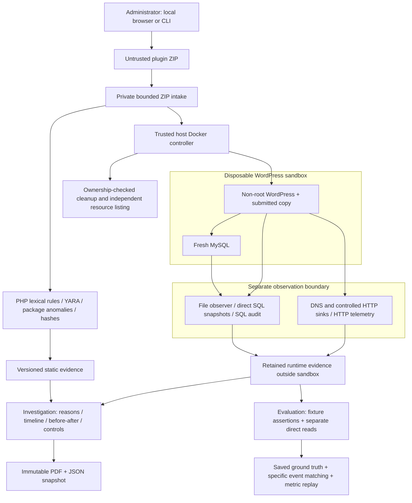

# Delivered architecture and trust boundaries

The host and Docker daemon are trusted; submitted names and code are untrusted.
Containers share a kernel. The submitted container has no host source bind mount
or Docker socket. Ground truth is separate from monitor events but relies on
trusted authored fixture assertions for transient/network operations. Reports
contain untrusted text rendered safely. The local single-user interface is not
a production multi-user service. Legacy web/ lab infrastructure is excluded.
