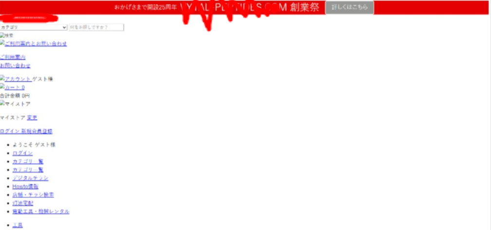

# VETO Lab

WordPress lab site for the **VETO** project (plugin analysis sandbox target).  
Full project documentation: [../README.md](../README.md)

## Motivation artifact

SEO-spam compromise that motivated the project:



*Client site after a malicious / fake plugin injected foreign SEO content and broke the storefront UI.*

## Quick start

```bash
cp .env.example .env
docker compose up -d
docker compose -f docker-compose.cega.yml up -d
```

| Role | URL |
|------|-----|
| WordPress | http://localhost:8080 |
| API | http://localhost:3001 |
